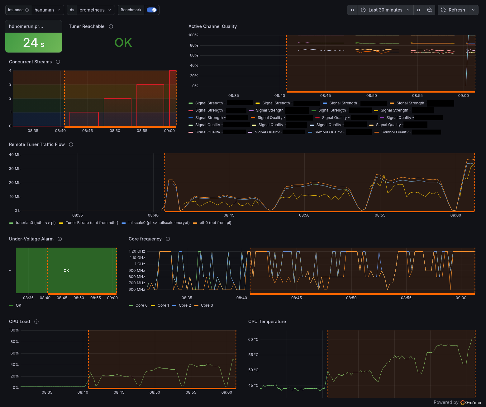

# grafana

Dashboard for the remote tuner Pi. Tuner status, stream throughput, and Pi health. Built for watching benchmark runs and comparing hardware.

  

## panels

| Panel | Shows |
|---|---|
| hdhomerun.prom file age | Seconds since the HDHomeRun metrics were last written. Should stay under ~30 s |
| Tuner Reachable | Whether the Pi can reach the HDHomeRun's status page |
| Concurrent Streams | Number of tuners in use |
| Active Channel Quality | Signal strength, signal quality and symbol quality per active tuner |
| Remote Tuner Traffic Flow | tunerlan0 in (from the tuner), tuner bitrate as reported by the HDHomeRun, tailscale0 out, eth0 out. tunerlan0 and the tuner bitrate should match |
| Under-Voltage Alarm | Raspberry Pi firmware under-voltage flag |
| Core frequency | Per-core clock. High load with a clock below the maximum means throttling |
| CPU Load | Non-idle CPU time averaged over all cores |
| CPU Temperature | SoC temperature |

Under-Voltage Alarm and Core frequency use Raspberry Pi specific metrics.

## benchmark annotation

`benchmark.yml` writes `tuner_benchmark_running 1` to the Pi's textfile collector while a test runs and deletes it afterwards. The `Benchmark` annotation queries that metric and shades the run on every panel. Toggle it at the top of the dashboard. Rounds show as steps in Concurrent Streams.